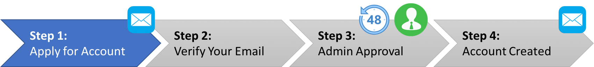
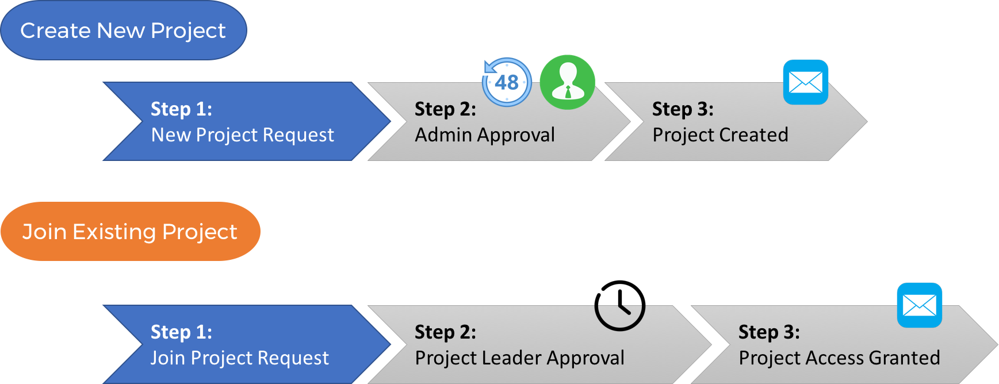

# Accounts and Projects

Apply for a Swinburne HPC account, manage your password and two-year renewal, and create or join a research project to access shared storage and compute queues on Ngarrgu Tindebeek (NT), OzSTAR, and Trevor.

## Eligibility

Accounts are available free of charge to:

- Swinburne staff and students.
- Researchers working in astronomy and space sciences based at publicly funded research institutions within Australia.
- Approved international collaborators working on an existing approved project (international collaborators cannot be the lead on a research project).

Every account must be linked to at least one project — either a general access project representing a research group or a project approved through a merit allocation scheme (MAS). All account holders must comply with Swinburne HPC's [Policies](../1-getting_started/Policies.rst).

## Requesting a new account



1. Complete the [New Account Request form](https://supercomputing.swin.edu.au/account-management/new_account_request) with your details.
2. Check your inbox (and spam folder) for the email verification message and verify your address.

   :::{note}
   If the verification email does not arrive, check your spam folder first and confirm that you entered your email address without typos.
   :::

3. Wait for the HPC admin team to review and approve your request (up to 48 hours). You cannot sign in to the Accounts Portal until your account is approved.
4. Once approved, you receive an email containing your OzSTAR username.
5. Before connecting via SSH for the first time, sign in to the [Accounts Portal](https://supercomputing.swin.edu.au/account-management/) and complete [Two-Factor Authentication (2FA)](2fa.md) enrollment.

## Managing your account

Use the [Accounts Portal](https://supercomputing.swin.edu.au/account-management/) to update your contact details, check account expiry, manage project memberships, and configure 2FA.

:::{important}
OzSTAR accounts are completely separate from Swinburne University logins. Always keep your email address up to date in the Accounts Portal, as important system notices are sent only to your registered email address (see [Policies](../1-getting_started/Policies.rst)).
:::

### Account expiry and renewal

Accounts are valid for **2 years**. If your account expires, SSH logins fail with `Permission denied`. Sign in to the [Accounts Portal](https://supercomputing.swin.edu.au/account-management/) to check your expiry date or submit a renewal request, or email `hpc-support@swin.edu.au` if you need assistance.

### Changing or resetting your password

- **While logged in via SSH:** Run `passwd` on any login node and follow the prompts (see the Linux [`passwd(1)` manual page](https://man7.org/linux/man-pages/man1/passwd.1.html) for options):

  ```bash
  passwd
  ```

- **If you have forgotten your password:** Reset it via the [Accounts Portal password reset page](https://supercomputing.swin.edu.au/account-management/forget_password).

## Projects

Your account must belong to at least one project for management, reporting, and Lustre filesystem quota tracking. An account can belong to multiple projects at the same time (for example, a default research group project and a MAS project).

### General access projects vs. MAS projects

- **General access projects** represent a research group or department. A group leader creates the project and students or postdocs join it as their default project. General access jobs share the standard compute queues, while `/fred/<project>` disk quotas are allocated per project.
- **Merit Allocation Scheme (MAS) projects** are created for proposals awarded dedicated compute credits (such as Astronomy Australia Ltd's ASTAC allocations). To charge jobs to a MAS project and apply its priority queue settings, specify `#SBATCH --account=<mas_project>` in your Slurm job script — see [Merit Allocation Scheme (MAS) projects](../jobs/creating-jobs.md#merit-allocation-scheme-mas-projects).

:::{note}
Students cannot be the leader of a project. If you are a student and need a new project, ask your supervisor to create the project so you can join it.
:::



### Create a new project

1. Submit a new project request through the [Accounts Portal](https://supercomputing.swin.edu.au/account-management/).
2. Wait for the HPC admin team to review and approve your request (up to 48 hours).
3. Once approved, you receive a confirmation email and a project directory is created at `/fred/<project>` (see [Filesystems and Storage](../storage/filesystems.md)).

### Join an existing project

1. Contact the project leader before submitting your request so they expect it.
2. Submit a project join request through the [Accounts Portal](https://supercomputing.swin.edu.au/account-management/).
3. Once the project leader approves your request, you receive a confirmation email and are automatically added to the project's Linux group, granting access to `/fred/<project>` and its storage quota.

## Next steps

- [Two-Factor Authentication (2FA)](2fa.md) — enroll in 2FA before your first SSH login.
- [Policies](../1-getting_started/Policies.rst) — review acceptable use, data storage, AI tool, and acknowledgement rules.
- [Connecting via SSH](../access/ssh-access.md) — log in to NT, OzSTAR, Trevor, and the data-movers.
